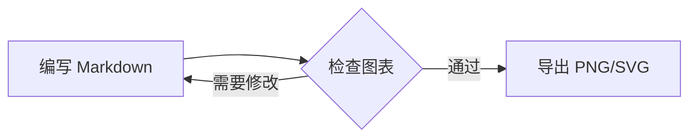

# Markdown & Mermaid Viewer

一个离线运行的 Markdown 与 Mermaid 桌面预览器，提供 Windows Electron 版和 macOS 原生版。应用适合阅读本地 Markdown 文档、查看宽幅流程图，并将 Mermaid 图表导出为 PNG 或 SVG。

## 功能

- 打开 `.md` 和 `.markdown` 文件，也支持拖放文件。
- Markdown 渲染支持 GFM 风格语法、表格、代码块、引用和链接。
- Mermaid 图表渲染，适合流程图、状态图等宽幅图表。
- 文件变化实时监听并自动刷新。
- Mermaid 图表缩放、平移、重置、适应窗口和全屏查看。
- 一键复制或导出 PNG，导出 SVG。
- 打印 Markdown 页面或导出为 PDF。
- 全宽/全景模式和系统明暗主题适配。
- 离线运行，Markdown 与 Mermaid 前端资源随应用打包。
- Windows 支持 `.md`/`.markdown` 文件关联、NSIS 安装包和便携版 EXE。
- macOS 支持文件关联、拖放，以及 Apple Silicon 和 Intel 的通用安装包。

## 项目结构

```text
.
├── electron/
│   ├── main.js                 # Electron 主进程
│   ├── preload.js              # 安全桥接 API
│   ├── src/
│   │   ├── file-service.js     # 文件读取、编码兼容和监听
│   │   ├── launch-file.js      # 启动参数中的 Markdown 文件解析
│   │   └── main-handlers.js    # 文件选择、导出、复制和打印 IPC
│   ├── renderer/index.html     # Markdown/Mermaid 页面
│   ├── renderer/vendor/        # 离线 marked 和 mermaid 资源
│   └── tests/                  # Node 内置测试
├── macos-viewer/
│   ├── src/main.swift          # Cocoa + WebKit 原生应用
│   ├── resources/              # 页面和离线资源
│   ├── Info.plist              # macOS 应用信息和文件关联
│   ├── build.sh                # 构建 .app
│   └── package.sh              # 构建通用架构 ZIP/DMG
└── docs/superpowers/           # 设计、计划和执行记录
```

## Windows：Electron 版

### 环境要求

- Windows 10/11
- Node.js 和 npm
- 构建安装包需要 NSIS；仓库提供 `electron/tools/nsis-3.0.4.1.7z`

### 安装与运行

```powershell
cd electron
npm ci
npm start
```

启动后可以点击文件选择按钮，或将 Markdown 文件拖入窗口。也可以直接从命令行打开文件：

```powershell
npm start -- C:\path\to\document.md
```

### 测试

```powershell
cd electron
npm test
```

测试使用 Node 内置测试运行器，覆盖文件读取与监听、启动文件解析、preload API 白名单和渲染器契约。

### 构建安装包

先将 `electron/tools/nsis-3.0.4.1.7z` 解压为：

```text
electron/tools/nsis-3.0.4.1/
```

然后执行：

```powershell
cd electron
npm run dist
```

或直接执行：

```powershell
cd electron
build.bat
```

输出位于 `electron/release/`，包括 NSIS 安装包和 portable EXE。`build.bat` 会先执行 `npm ci`，再执行打包。

## macOS：原生版

### 环境要求

- macOS 12.0 或更高版本
- Xcode Command Line Tools
- `swiftc`、Cocoa、WebKit
- 生成 DMG 时还需要 `lipo`、`codesign`、`ditto` 和 `hdiutil`

### 构建并运行

构建当前机器架构的 App：

```bash
cd macos-viewer
./build.sh
open dist/MarkdownViewer.app
```

也可以打开指定 Markdown 文件：

```bash
open -a "$(pwd)/dist/MarkdownViewer.app" path/to/document.md
```

### 生成发布包

```bash
cd macos-viewer
./package.sh
```

该脚本会分别编译 `arm64` 和 `x86_64`，合并为通用架构 App，并在 `macos-viewer/dist/` 生成：

- `MarkdownViewer-macOS.zip`
- `MarkdownViewer-Installer.dmg`

## Markdown 与 Mermaid 示例

在 Markdown 文件中使用 `mermaid` 代码块即可渲染图表：

````markdown
# 发布流程


````

如果 Mermaid 语法错误，页面会保留错误信息和原始代码，便于定位问题。

## 编码与安全

- Electron 主进程启用 `contextIsolation`，关闭 renderer 的 Node 集成；渲染器只能通过 `preload.js` 暴露的白名单 API 与主进程通信。
- 文件读取支持 UTF-8、UTF-8 BOM；检测到乱码替换字符时会尝试使用 GB18030 解码。
- 应用只读取用户主动打开或拖入的本地文件，不上传 Markdown 内容。
- `electron/renderer/vendor/` 和 `macos-viewer/resources/` 中的 `marked.min.js`、`mermaid.min.js` 为离线运行时资源；升级时应同步版本并记录来源。

## 开发注意事项

- 修改 Electron IPC 时，同时检查 `main.js`、`preload.js`、`src/main-handlers.js` 和对应测试。
- 修改渲染页面时，若行为也应在 macOS 可用，需要同步更新 `macos-viewer/resources/index.html`。
- 不要提交 `electron/node_modules/`、`electron/release/`、`electron/tools/nsis-3.0.4.1/`、`macos-viewer/dist/`、用户文档、个人路径或签名材料。
- 当前仓库没有统一 lint 命令，也没有 macOS 自动化测试；涉及 UI、文件监听、导出或打包的改动应进行手动验证。

## 许可证

当前仓库未提供独立的许可证文件。对外发布前，请先确认项目许可证、第三方依赖和离线资源的授权条款。
